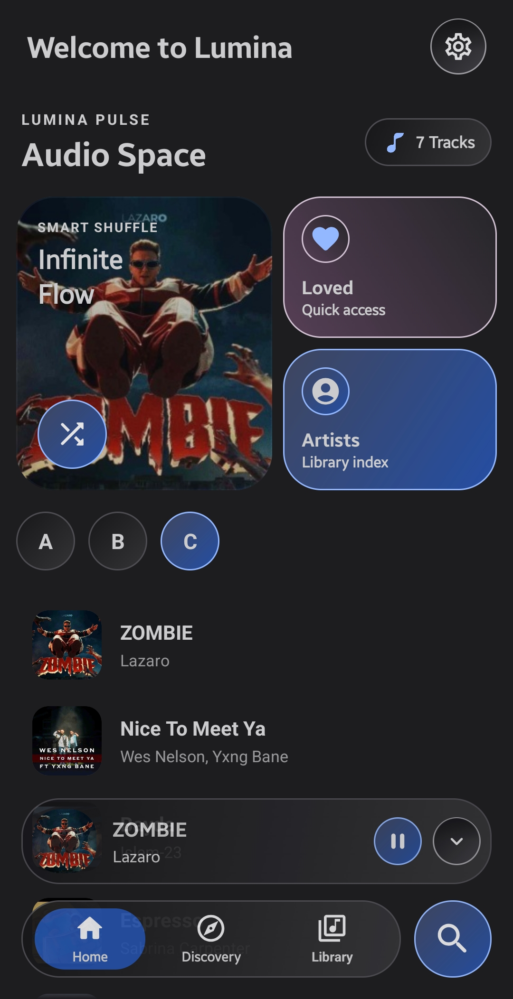
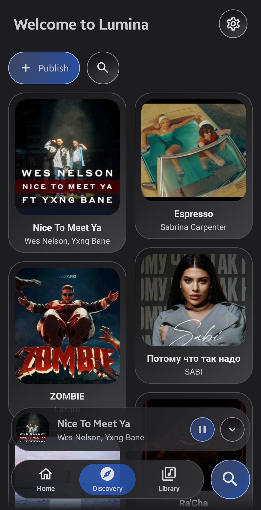
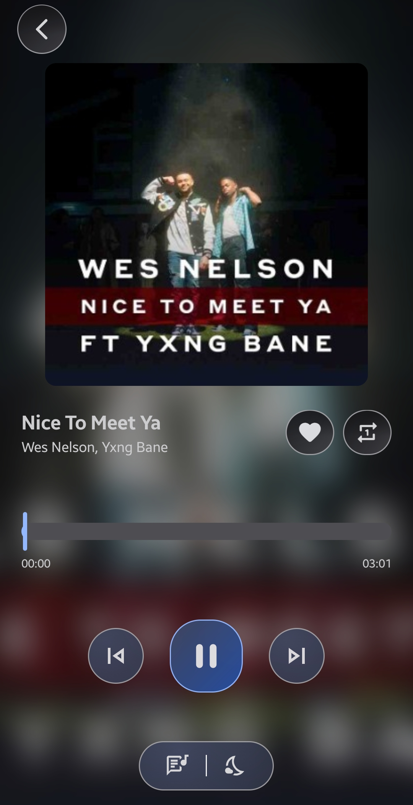
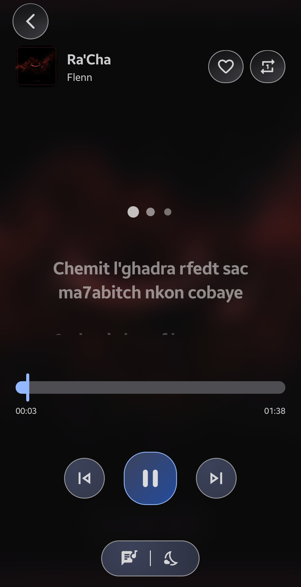
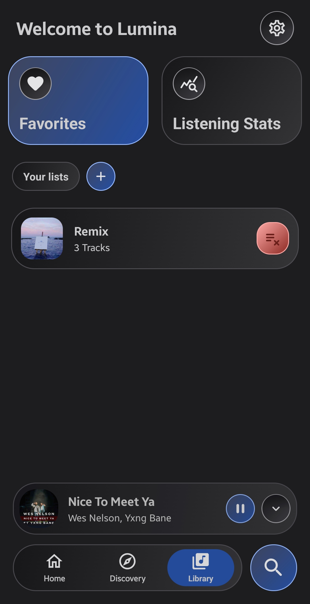
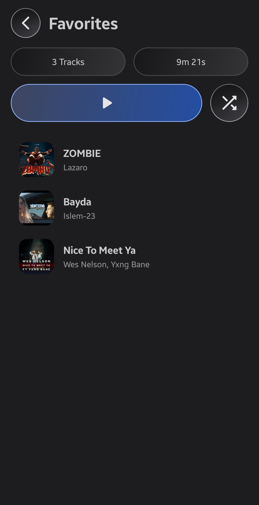
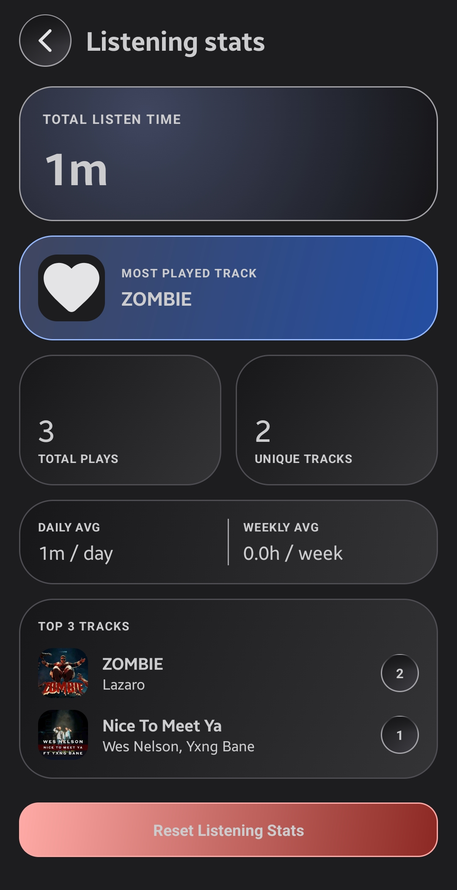

  

<h1 align="center">Lumina Sound</h1>

  <b>Lumina Sound is a refined music player giving you total control over your audio library through a smooth, ad-free interface tailored to your preferences.</b>

---

## Features

* **Online Discovery & Sharing**: Explore new music online and seamlessly share your favorite tracks and musical discoveries with other users.
* **High-Fidelity Audio**: Delivers crisp, rich sound playback with dynamic audio output for an immersive listening experience.
* **Real-Time Synced Lyrics**: Displays perfectly synchronized lyrics with smooth line-by-line scrolling that tracks your song precisely.
* **Smart Sleep Timer**: Set custom countdowns with quick increment controls ($\pm 5$ min) to auto-stop playback seamlessly.
* **Instant Favorites**: Save and access your most-cherished tracks instantly with a single tap.
* **Custom Playlists**: Effortlessly create, edit, and organize personalized song collections tailored to your vibe.
* **Listening Insights**: Track your music habits with detailed stats, including total listen time, top-played tracks, and daily trends.

---

## Screenshots

  <table>
    <tr>
      <td align="center" width="33%">
        
         
        <b>Home</b>
      </td>
      <td align="center" width="33%">
        
         
        <b>Discovery</b>
      </td>
      <td align="center" width="33%">
        
         
        <b>Player</b>
      </td>
    </tr>
    <tr>
      <td align="center" width="33%">
        
         
        <b>Lyrics</b>
      </td>
      <td align="center" width="33%">
        
         
        <b>Library</b>
      </td>
      <td align="center" width="33%">
        
         
        <b>Favorite</b>
      </td>
    </tr>
    <tr>
      <td align="center" width="33%">
        
         
        <b>Stats</b>
      </td>
      <td align="center" width="33%"></td>
      <td align="center" width="33%"></td>
    </tr>
  </table>

